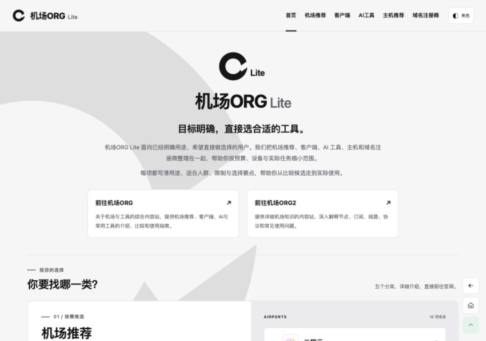
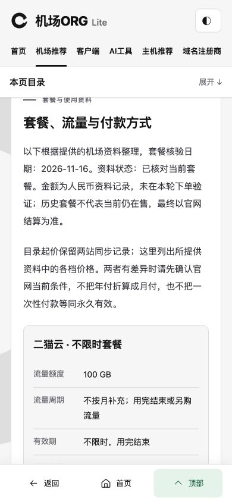

# 机场ORG Lite

### 目标明确，直接选合适的工具。

机场推荐 · 客户端 · AI 工具 · 主机推荐 · 域名注册商

**先明确用途，再看介绍，最后前往官网。**

> [!TIP]
> **Star 收藏正式入口。** 本仓库提供网站介绍、页面预览与阅读导航；完整内容与更新请访问 [jichangorg-lite.co](https://jichangorg-lite.co/)。

机场ORG Lite 面向已经知道自己要做什么、希望直接比较并选择工具的用户。我们把机场推荐、客户端下载、AI 工具、主机和域名服务放在一起，用详细介绍说明用途、适合人群、限制与选择依据，让你按预算、设备和实际任务缩小范围。

## 从你的目的开始

| 你要找的内容 | 收录 | 先比较什么 |
| --- | --- | --- |
| **[机场推荐](https://jichangorg-lite.co/airports/)** | 16 项 | 预算、套餐、流量与客户端要求 |
| **[客户端](https://jichangorg-lite.co/clients/)** | 10 项 | 系统兼容、订阅格式与官方下载 |
| **[AI 工具](https://jichangorg-lite.co/ai-tools/)** | 10 项 | 写作、研究、编程与图像任务 |
| **[主机推荐](https://jichangorg-lite.co/hosting/)** | 6 项 | 静态托管、云服务器与维护成本 |
| **[域名注册商](https://jichangorg-lite.co/registrars/)** | 5 项 | 注册、续费、转入与管理条件 |

每个分类都有两篇入门文章，包括一篇“该怎么选”；每个项目都有独立介绍和官网入口。机场套餐还提供单独的“前往购买”入口。

## 2026 机场推荐清单

名单与默认顺序沿用机场ORG、机场ORG2的已核对资料。便宜机场与性价比机场应结合流量、付款周期、设备要求一起比较；寻找 Clash机场、v2ray机场 时，先确认第三方客户端兼容条件。

| 机场 | 适合关注的需求 | 详细资料 |
| --- | --- | --- |
| **二猫云** | 愿意使用配套客户端，比较周期与总量方案的用户 | [查看介绍与套餐](https://jichangorg-lite.co/airports/ermaoyun/) |
| **闪电鼠** | 希望从月付开始了解服务的用户 | [查看介绍与套餐](https://jichangorg-lite.co/airports/shandianshu/) |
| **瞬云** | 在月付和备用总量包之间选择的用户 | [查看介绍与套餐](https://jichangorg-lite.co/airports/shunyun/) |
| **环球梯** | 需要比较不同用量和使用期限的用户 | [查看介绍与套餐](https://jichangorg-lite.co/airports/huanqiuti/) |
| **大佬云** | 想比较固定月付和偶尔使用成本的用户 | [查看介绍与套餐](https://jichangorg-lite.co/airports/dalaoyun/) |
| **神行加速** | 想同时了解周期和总量计费的用户 | [查看介绍与套餐](https://jichangorg-lite.co/airports/shenxing/) |
| **速界** | 希望短周期了解服务后再选常规套餐的用户 | [查看介绍与套餐](https://jichangorg-lite.co/airports/sujie/) |
| **快狸** | 希望从较小流量档位开始的用户 | [查看介绍与套餐](https://jichangorg-lite.co/airports/kuaili/) |
| **边缘** | 想比较低用量周期方案与备用包的用户 | [查看介绍与套餐](https://jichangorg-lite.co/airports/edge/) |
| **隐形人** | 愿意根据用量选择档位或了解定制条件的用户 | [查看介绍与套餐](https://jichangorg-lite.co/airports/invisible/) |
| **灵猫网络** | 接受使用专用客户端的用户 | [查看介绍与套餐](https://jichangorg-lite.co/airports/civet/) |
| **鲲鹏加速** | 希望少看几个档位、快速判断预算的用户 | [查看介绍与套餐](https://jichangorg-lite.co/airports/kunpeng/) |
| **速网云** | 需要订阅导入、希望比较低预算方案的用户 | [查看介绍与套餐](https://jichangorg-lite.co/airports/suwangyun/) |
| **云图机场** | 愿意先核对现行套餐再做决定的用户 | [查看介绍与套餐](https://jichangorg-lite.co/airports/yuntu/) |
| **全球云** | 能接受专用客户端、需要不同计费方式的用户 | [查看介绍与套餐](https://jichangorg-lite.co/airports/globalcloud/) |
| **U1S1** | 接受配套客户端、按用量选择周期套餐的用户 | [查看介绍与套餐](https://jichangorg-lite.co/airports/u1s1/) |

[查看完整机场排行 →](https://jichangorg-lite.co/airports/)　[机场该怎么选 →](https://jichangorg-lite.co/guides/airport-how-to-choose/)　[月付、年付与按量怎么选 →](https://jichangorg-lite.co/guides/airport-billing/)

价格和服务条件可能调整，历史资料与有差异的记录会明确标注，购买前以服务商结算页面为准。收录顺序不代表测速评分或效果保证。[推荐方法](https://jichangorg-lite.co/methodology/) · [推广合作说明](https://jichangorg-lite.co/disclosure/)

## 轻量体验，详细介绍

<table>
<tr>
<td width="34%" align="center"></td>
<td>

### 更快找到需要的信息

- **五个分类**：从目的出发，直接进入需要的目录。
- **详细专页**：介绍、使用条件、套餐与官方入口集中查看。
- **手机目录**：折叠展开，跳到介绍、套餐或客户端。
- **快捷导航**：返回上一页、首页、一键回到顶部。
- **明暗主题**：默认亮色，也支持深色和跟随系统。

[查看所有项目与文章 →](NAVIGATION.md)

</td>
</tr>
</table>

## 本站推荐

| 二猫云 | Cloudflare Workers | Spaceship |
| --- | --- | --- |
| 比较机场套餐与客户端条件 | 了解静态托管与边缘应用 | 比较域名注册、续费和转入 |
| [查看介绍](https://jichangorg-lite.co/airports/ermaoyun/) | [查看介绍](https://jichangorg-lite.co/hosting/cloudflare/) | [查看介绍](https://jichangorg-lite.co/registrars/spaceship/) |

## 三个站点，三种用途

| 站点 | 定位 | 正式入口 |
| --- | --- | --- |
| **机场ORG · 主站** | 关于机场与工具的综合内容站 | [前往机场ORG](https://jichangorigin.blog/) |
| **机场ORG2 · 副站** | 提供详细机场知识的内容站 | [前往机场ORG2](https://jichangorg2.blog/) |
| **机场ORG Lite** | 目标明确，直接挑选合适的工具 | [前往机场ORG Lite](https://jichangorg-lite.co/) |

## 联系与反馈

发现信息变化、链接问题或介绍需要补充，可通过 [联系与纠错](https://jichangorg-lite.co/contact/) 反馈。请不要在公开 Issue 中填写密码、订阅链接、订单或支付资料。

本仓库为公开展示与导航仓库，**不包含网站源代码、部署配置或私有资料**。网站及原创内容保留所有权利，第三方商标归各自权利人所有。© 2026 机场ORG Lite。
